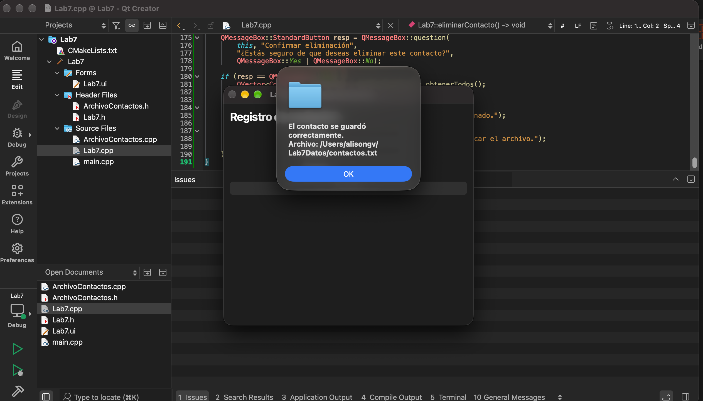
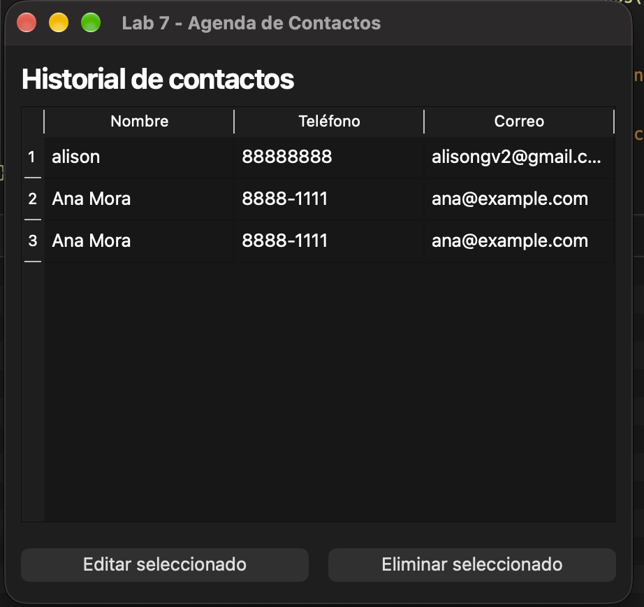

# Lab 7 - Agenda de Contactos (Qt C++)

## Información de entrega
- **Curso:** Programación 1
- **Laboratorio:** 7 - Sistema de Gestión de Contactos

## Evidencia de funcionamiento

### Captura 1: Confirmación de Guardado

### Captura 2: Historial, Edición y Eliminación

## Detalles técnicos
- **Ruta de persistencia:** `~/Lab7Datos/contactos.txt`
- **Edición/Eliminación:** Implementadas mediante cuadros de diálogo (`QInputDialog` / `QMessageBox`) y actualización limpia del archivo `.txt`.
