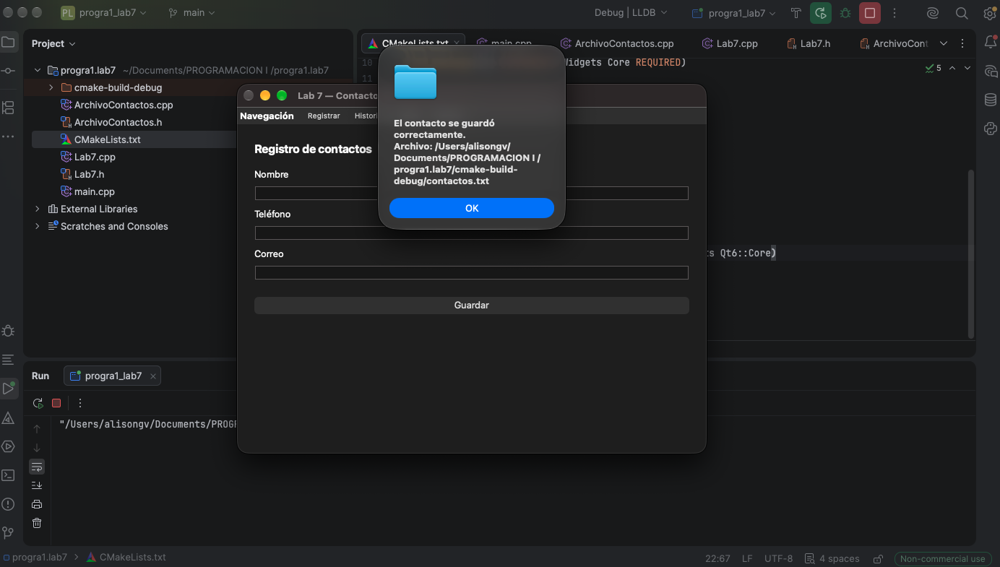
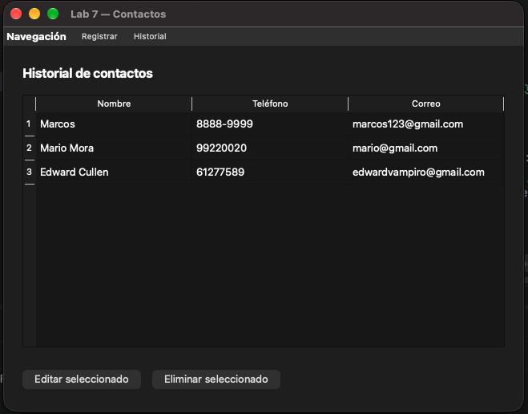

# Laboratorio 7 — Creación de Aplicaciones de Escritorio con C++ y Qt

**Curso:** Programación 1  
**Estudiante:** Alison González Vásquez  
**Institución:** Universidad Nacional de Costa Rica — Sede Regional Chorotega  
**Profesor:** M.S. Alex Villegas Carranza

---

##  Descripción del Proyecto

Esta aplicación de escritorio desarrollada con **C++** y el framework **Qt Widgets** permite gestionar una agenda de contactos local con un sistema de almacenamiento persistente en archivo plano de texto (`.txt`).

La aplicación incluye dos vistas principales organizadas mediante `QStackedWidget`:
1. **Formulario de Registro / Edición:** Permite ingresar o actualizar el nombre, teléfono y correo electrónico de una persona.
2. **Historial de Contactos:** Muestra todos los contactos almacenados en una tabla (`QTableWidget`) permitiendo seleccionar registros para modificarlos o eliminarlos.

---

##  Tecnologías y Herramientas Utilizadas

* **Lenguaje:** C++20
* **Framework:** Qt 6 (Qt Widgets, Core, Gui)
* **IDE & Sistema de Construcción:** CLion & CMake (macOS arm64)
* **Control de Versiones:** Git & GitHub

---

##  Archivos del Proyecto y Persistencia

### Ruta del Archivo `.txt`
Los datos se almacenan de manera persistente en formato CSV (delimitado por punto y coma `;`) en la siguiente ubicación local:
```text
<directorio_del_proyecto>/contactos.txt
```
*(Obtenida dinámicamente mediante `QDir::currentPath() + "/contactos.txt"`)*.

### Estructura del Archivo
Cada registro se guarda en una línea independiente con la estructura:
```text
Nombre;Teléfono;Correo
```

---

##  Explicación Técnica de Operaciones (CRUD)

1. **Guardar (Append):** Al registrar un contacto nuevo, los datos son validados y concatenados al final del archivo mediante `QIODevice::Append`.
2. **Cargar Historial (Read):** Al ingresar al historial, se lee el archivo línea por línea con `QTextStream`, dividiendo los datos por el delimitador `;` para llenar la tabla `QTableWidget` sin duplicar información.
3. **Editar y Eliminar (Overwrite / Safe Write):**
    * **Edición:** Al seleccionar una fila en la tabla y presionar *Editar seleccionado*, los datos del contacto se cargan automáticamente en el formulario de registro y la interfaz cambia al modo *Actualizar*.
    * **Eliminar:** Al confirmar la eliminación de un contacto, el registro se remueve de la lista en memoria (`QVector<Contacto>`).
    * **Persistencia:** Ambas operaciones reescriben el archivo completo de forma segura utilizando la clase **`QSaveFile`**, garantizando que el archivo no se corrompa si ocurre algún error durante la escritura.

---

##  Comprobación de Funcionamiento

* **Validación de Datos:** Se verificó que la aplicación impida el guardado si hay campos vacíos o si los datos ingresados contienen el caracter de control `;`.
* **Persistencia:** Se comprobó cerrando y reiniciando la aplicación tras realizar modificaciones y eliminaciones, verificando que los datos persistieran correctamente en el archivo `.txt`[cite: 1].

---

##  Capturas de Pantalla

### Confirmación de Guardado


### Historial de Contactos
